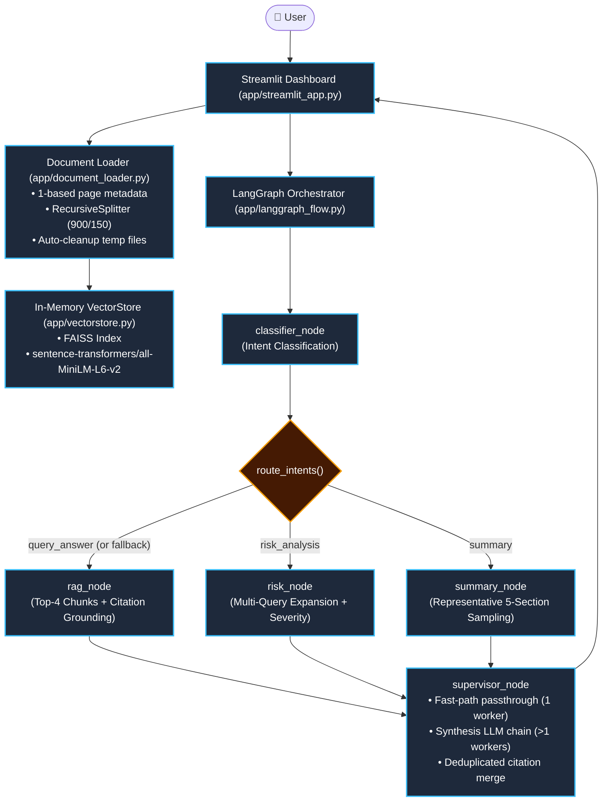
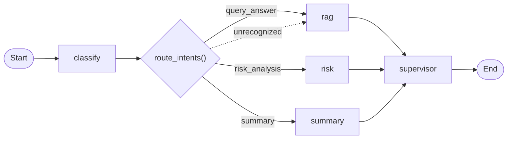

# 🤖 Contract Review Bot (LangGraph + Streamlit)

[](https://www.python.org/)
[](https://langchain-ai.github.io/langgraph/)
[](https://ai.google.dev/)
[](https://streamlit.io/)
[]()

An AI-powered legal document review and contract intelligence assistant built with **LangGraph**, **Google Gemini 2.5 Flash**, **FAISS**, and **Streamlit**. The system ingests PDF and TXT contracts, extracts page-grounded text chunks, coordinates specialized reasoning nodes via a directed state machine, and provides structured legal risk assessments, executive summaries, and clause Q&A.

---

## 📑 Table of Contents
- [Architecture Overview](#-architecture-overview)
- [Key Features](#-key-features)
- [LangGraph Workflow](#-langgraph-workflow)
- [System Documentation](#-system-documentation)
- [Technology Stack](#-technology-stack)
- [Setup & Installation](#-setup--installation)
- [Running the Application](#-running-the-application)
- [Running the Test Suite](#-running-the-test-suite)
- [Reliability & Security Considerations](#-reliability--security-considerations)
- [Known Limitations](#-known-limitations)
- [Future Enhancements](#-future-enhancements)

---

## 🏛 Architecture Overview

The system decouples ingestion, in-memory semantic indexing, state orchestration, and presentation into clean, maintainable layers:



For full architectural breakdowns, see [`docs/architecture.md`](docs/architecture.md) and [`docs/architecture.svg`](docs/architecture.svg).

---

## 🧠 Key Features

- **Page-Aware Ingestion**: PDF pages are indexed with normalized 1-based integers (`page_number`). Recursive text splitting (900 chars, 150 overlap) prevents token truncation by sentence-transformer models.
- **Strict Citation Grounding**: Responses reference verified document pages (`[Page 1, 4]`). Hallucinated page numbers generated by LLMs are programmatically stripped against actual retrieved evidence.
- **Categorized Risk Scoring**: Clauses are analyzed for liabilities, uncapped damages, and one-sided termination, tagging overall severity as **High** 🔴, **Medium** 🟡, or **Low** 🟢.
- **Structured Executive Summarization**: Uses representative sampling across document preamble, body, and tail to generate 5-section legal summaries rather than naive keyword search.
- **LangGraph State Orchestration**:
  - Typed state transitions via `GraphState`.
  - Single-node **fast-path passthrough** eliminating redundant LLM synthesis calls.
  - Multi-intent fan-out execution when users request both summaries and risk evaluations.
  - Defensive fallback routing to prevent empty-branch graph deadlocks.
- **Resource Caching & Ephemeral Privacy**: Embeddings are cached via `@st.cache_resource`, while FAISS vectors reside strictly in session memory—contracts are never permanently stored on disk.
- **Exportable Audit Reports**: One-click Markdown audit report download directly from the Streamlit sidebar.

---

## 🔄 LangGraph Workflow

The state machine graph defined in [`app/langgraph_flow.py`](app/langgraph_flow.py):



For complete node specifications, see [`docs/langgraph-workflow.md`](docs/langgraph-workflow.md).

---

## 📚 System Documentation

Comprehensive system-design artifacts prepared for technical interviews and architectural reviews:

| Document | Description |
| :--- | :--- |
| **[`docs/architecture.md`](docs/architecture.md)** | End-to-end component breakdown, data flow, and technology mapping |
| **[`docs/architecture.svg`](docs/architecture.svg)** | Standalone vector graphic of the system architecture |
| **[`docs/langgraph-workflow.md`](docs/langgraph-workflow.md)** | Detailed state machine node specifications and routing logic |
| **[`docs/request-lifecycle.md`](docs/request-lifecycle.md)** | Step-by-step execution lifecycle with Mermaid sequence diagram |
| **[`docs/design-decisions.md`](docs/design-decisions.md)** | In-depth engineering trade-offs and scaling strategies (1k–10k users) |
| **[`docs/reliability-and-security.md`](docs/reliability-and-security.md)** | Security audit, vulnerability analysis, and reliability safeguards |

---

## 🛠 Technologies Used

| Category | Technology | Purpose |
| :--- | :--- | :--- |
| **User Interface** | `Streamlit` | Web dashboard, chat history, sidebar stats, file uploader |
| **Orchestrator** | `LangGraph` | Stateful directed graph, conditional fan-out, supervisor join |
| **Foundation Model** | `Google Gemini 2.5 Flash` | Classification, RAG synthesis, risk scoring via Pydantic schemas |
| **Embeddings** | `Sentence-Transformers` (`all-MiniLM-L6-v2`) | Local CPU dense vector embeddings (384 dimensions) |
| **Vector Search** | `FAISS` (`faiss-cpu`) | In-memory similarity search and semantic indexing |
| **Document Loaders** | `LangChain Core / Community` (`pypdf`) | PDF/TXT extraction and recursive character text splitting |
| **Validation** | `Pydantic v2` | Typed schema contracts (`QueryOutput`, `IntentOutput`) |

---

## 🔧 Setup & Installation

### 1. Clone the Repository
```bash
git clone https://github.com/sawanrepo/Contract-review-bot.git
cd Contract-review-bot
```

### 2. Create and Activate Virtual Environment
```bash
# On Windows:
python -m venv venv
venv\Scripts\activate

# On Linux/macOS:
python3 -m venv venv
source venv/bin/activate
```

### 3. Install Dependencies
```bash
pip install -r requirements.txt
```

### 4. Configure Environment Variables
Copy `.env.template` to `.env`:
```bash
# On Windows:
copy .env.template .env

# On Linux/macOS:
cp .env.template .env
```
Open `.env` and configure your API keys:
```ini
GOOGLE_API_KEY=your_gemini_api_key_here
MODEL_NAME=gemini-2.5-flash
TAVILY_API_KEY=your_tavily_key_optional
```

---

## 🚀 Running the Application

Start the Streamlit dashboard:
```bash
streamlit run app/streamlit_app.py
```
Open your browser at `http://localhost:8501`.

> **Note**: A custom [`.streamlit/config.toml`](.streamlit/config.toml) is pre-configured with `fileWatcherType = "none"` to suppress PyTorch module inspection warnings on startup.

---

## 🧪 Running the Test Suite

The project includes **28 automated unit tests** covering document loading, chunking, unsupported formats, FAISS search, intent routing, citation grounding, node fallbacks, and external tool handling. External API calls (Gemini, Tavily) are fully mocked so tests run offline in **~0.1 seconds** with zero API costs:

```bash
# Run test suite via standard unittest discovery:
python -m unittest discover -s tests -p "test_*.py" -v
```

### Test Suite Structure:
- `tests/test_document_loader.py`: TXT loading, 900-char chunk boundaries, unsupported extension rejection, temp file cleanup.
- `tests/test_vectorstore.py`: Empty search handling, document addition, vector reset, model-keyed embedding cache.
- `tests/test_classifier_and_routing.py`: Structured intent classification, error fallback, multi-branch routing.
- `tests/test_nodes_and_graph.py`: RAG missing context, citation grounding against retrieved evidence, risk scoring, supervisor fast-path passthrough.
- `tests/test_tools.py`: Compliance checker error handling, Tavily API key absence checks.

---

## 🔒 Reliability & Security Considerations

- **Session Isolation**: Each browser tab operates on an isolated `st.session_state` with independent in-memory FAISS indices and conversation memories.
- **Safe Temp File Handling**: Uploaded files write to process-isolated paths (`temp/upload_{pid}_{name}`) and are deterministically deleted in a `finally` block immediately after text extraction.
- **Git Hygiene**: Local `.env` credentials, virtual environments, vector persistence folders, and uploaded PDF files are strictly ignored in [`.gitignore`](.gitignore).
- **Anti-Hallucination Guardrails**: Model-generated citations are programmatically intersected with chunks actually retrieved from vector search.

---

## ⚠️ Known Limitations

1. **In-Memory Ephemeral Storage**: Reloading the browser page resets the vector index, requiring the contract to be re-uploaded.
2. **Scanned PDF OCR**: `PyPDFLoader` extracts text from digital PDFs. Scanned PDFs (pure images without text layers) require an OCR pre-processor like Tesseract or AWS Textract.
3. **Free-Tier API Rate Limits**: Gemini Free Tier enforces a 5 RPM rate limit. Under heavy multi-user testing, responses may trigger rate limits; production use requires a Tier-1 API plan.

---

## 💡 Future Enhancements

- **Visual PDF Highlighting**: Render interactive PDF bounding boxes on cited clauses using PDF.js or pdf2image.
- **Persistent Multi-Tenancy**: Store vector embeddings in Qdrant or pgvector with tenant-isolated collection namespaces.
- **Hybrid Dense + Sparse Search**: Integrate BM25 keyword matching with dense vectors via Reciprocal Rank Fusion (RRF) for specialized legal terminology.
- **Dedicated ToolNode**: Expand `tools.py` into native LangGraph agent tool-calling with token budget caps.
