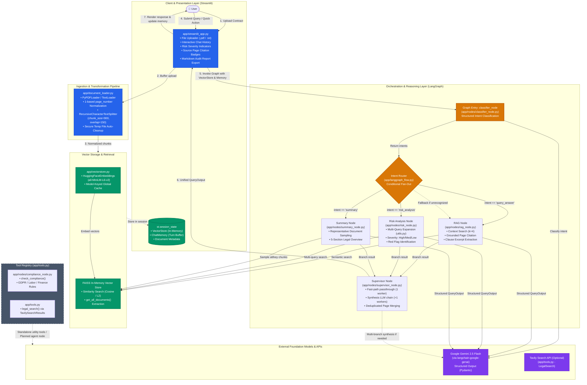

# System Architecture - Contract Review Bot

This document details the end-to-end system architecture of the **Contract Review Bot**, an AI-powered legal document analysis system combining **Streamlit**, **FAISS**, **LangGraph**, and **Google Gemini (gemini-2.5-flash)**.

---

## 1. High-Level Architecture Diagram

The system follows a modular pipeline spanning Document Ingestion, Semantic Indexing, State-Machine Orchestration, Multi-Node Reasoning, and Presentation.

---

## 2. Component Responsibilities

### A. Presentation & Session Layer (`app/streamlit_app.py`)
- **State Isolation**: Maintains conversation messages, active document statistics, and user query buffers in `st.session_state`.
- **Resource Caching**: Utilizes `@st.cache_resource` for the `sentence-transformers/all-MiniLM-L6-v2` embedding model, ensuring that heavy PyTorch model weights are loaded only once per server runtime.
- **Client Feedback**: Renders risk status badges (🔴 High, 🟡 Medium, 🟢 Low), citation chips (`Page 1, 4`), collapsible clause quote expanders, and report exports.

### B. Document Ingestion Pipeline (`app/document_loader.py`)
- **Format Normalization**: Handles both `.pdf` and `.txt` files.
- **Page Metadata Continuity**: Normalizes `PyPDFLoader`'s 0-indexed page metadata into consistent 1-indexed integers (`metadata["page_number"]`). Assigns page `1` to plain text files.
- **Recursive Text Splitting**: Chunks content using `RecursiveCharacterTextSplitter(chunk_size=900, chunk_overlap=150)` with paragraph, newline, and word boundaries.
- **Disk Cleanliness**: Employs unique process-isolated temporary file paths (`upload_{pid}_{filename}`) and cleans up disk files in a `finally` block immediately after extraction.

### C. Vector Engine & Embeddings (`app/vectorstore.py`)
- **Embeddings**: Uses `sentence-transformers/all-MiniLM-L6-v2` (384-dimensional dense vectors) on CPU.
- **Model Cache**: Implements an in-memory dictionary `_global_embeddings_cache` to store embedding model instances keyed by model name.
- **Session-Scoped Index**: In the web application, `VectorStore` instances remain in-memory per user session, eliminating file locking conflicts and cross-session contamination.
- **Document Access**: Exposes `get_all_documents()` alongside `search(query, k)` to allow representative sampling for contract-level summarization.

### D. LangGraph State Machine (`app/langgraph_flow.py`)
- **Typed State**: Uses `GraphState(TypedDict)` containing `query`, `memory`, `context`, `intents`, and intermediate node results.
- **Intent Router**: Routes to `rag`, `summary`, or `risk` nodes. Crucially, if classification returns empty or unrecognized intents, it enforces a fallback to `rag` to prevent execution deadlock.
- **Fan-Out Execution**: Supports single-intent routing or multi-intent branching (e.g., when a user asks to summarize and flag risks simultaneously).
- **Supervisor Join**: Consolidates results from active branches before reaching the `END` state.

### E. Reasoning Nodes (`app/nodes/`)
- **Classifier Node (`classifier_node.py`)**: Uses `ChatGoogleGenerativeAI.with_structured_output(IntentOutput)` to categorize user queries without fragile regex parsing.
- **RAG Node (`rag_node.py`)**: Retrieves top-4 semantic chunks, formats excerpts with page markers, injects recent conversation history, and invokes the LLM using `QueryOutput` schema. Filters returned citations against actual retrieved evidence.
- **Risk Node (`risk_node.py`)**: Executes multi-query retrieval (`utils.get_multiquery_docs`), scores overall risk severity (`high`, `medium`, `low`), and flags specific clause risks.
- **Summary Node (`summary_node.py`)**: Replaces flawed similarity search (`"summarize the contract"`) with representative document sampling across document sections, generating structured summaries covering Parties, Scope, Financials, Term, and Governing Law.
- **Supervisor Node (`supervisor_node.py`)**:
  - *Fast Path*: When only one analysis node was invoked, passes through the `QueryOutput` directly with zero added latency and zero additional token usage.
  - *Synthesis Path*: When multiple nodes were invoked, synthesizes cross-clause findings, merges page citations, and elevates the highest risk severity.

### F. Tools & Compliance Module (`app/tools.py` & `app/nodes/compliance_node.py`)
- **Compliance Checker**: Evaluates excerpts against international standards (GDPR, labor law, financial regulations).
- **Legal Search**: Connects to `TavilySearchResults` for external legal precedents when configured.
- *Status Note*: `tools.py` defines `TOOLS = [compliance_tool, legal_search_tool]`. These tools are currently standalone utility tools. They are not bound into LangGraph's active worker nodes, preventing runaway ReAct loops and staying within free-tier quota limits.

---

## 3. Technology Stack & Component Mapping

| Layer | Technology | Purpose |
| :--- | :--- | :--- |
| **Frontend** | Streamlit 1.45+ | Reactive web interface, session management, file upload, chat UI |
| **Orchestration** | LangGraph 0.4.5 | Stateful graph execution, conditional intent routing, supervisor aggregation |
| **LLM Provider** | Google Gemini 2.5 Flash | Structured reasoning, classification, summarization, risk scoring |
| **Embeddings** | Sentence-Transformers (`all-MiniLM-L6-v2`) | 384-dimensional dense semantic vector representation |
| **Vector Index** | FAISS (`faiss-cpu`) | High-performance in-memory similarity search |
| **Parsing & Chunking** | LangChain Core / Community, PyPDF | PDF/TXT extraction, page metadata tracking, recursive chunking |
| **Data Validation** | Pydantic v2 | Strict JSON schema enforcement for model responses |
