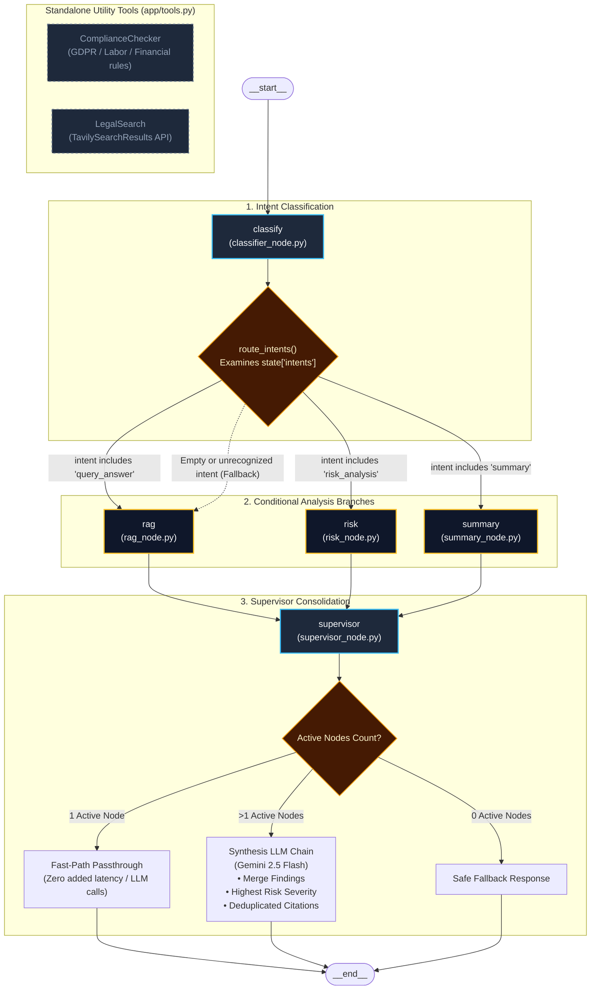

# LangGraph Workflow Architecture

This document describes the state machine workflow defined in [`app/langgraph_flow.py`](file:///d:/Contract-review-bot/app/langgraph_flow.py) and executed during user interactions.

---

## 1. State Machine Flowchart



---

## 2. Graph State Definition (`GraphState`)

The state dictionary (`TypedDict`, defined in [`app/schema.py`](file:///d:/Contract-review-bot/app/schema.py)) tracks execution progress across the graph lifecycle:

```python
class GraphState(TypedDict, total=False):
    query: str                  # The incoming user question or review prompt
    memory: List[dict]          # Chronological chat history ([{"role": ..., "content": ...}])
    context: Any                # In-memory VectorStore instance containing document embeddings
    intents: List[str]          # Classified intents: ['query_answer', 'summary', 'risk_analysis']
    rag_answer_node: Any        # QueryOutput from the RAG node
    summary_node: Any           # QueryOutput from the Summary node
    risk_analysis_node: Any     # QueryOutput from the Risk node
    final_answer: Any           # Final unified QueryOutput passed to Streamlit
```

---

## 3. Node Specifications & Responsibilities

### 1. `classify` (`app/nodes/classifier_node.py`)
- **Trigger**: Graph entry point.
- **Input**: `state["query"]`
- **Output**: `{"intents": intents}`
- **Operation**:
  - Uses `gemini-2.5-flash` with Pydantic structured output schema `IntentOutput`.
  - Classifies the prompt into one or more of:
    - `"query_answer"`: Specific clause questions, general terms, definitions.
    - `"summary"`: Requests for an overview, executive summary, or structural walkthrough.
    - `"risk_analysis"`: Requests focused on liabilities, uncapped risks, non-competes, or red flags.
  - **Error & Fallback Handling**: If the LLM throws a transient error, times out, or returns an empty list, the node catches the exception and falls back to `["query_answer"]`.

---

### 2. `route_intents` (Conditional Routing Edge)
- **Evaluation**:
  ```python
  def route_intents(state: GraphState):
      branches = []
      for intent in state.get("intents", []):
          if intent == "query_answer" and "rag" not in branches:
              branches.append("rag")
          elif intent == "summary" and "summary" not in branches:
              branches.append("summary")
          elif intent == "risk_analysis" and "risk" not in branches:
              branches.append("risk")
      if not branches:
          branches.append("rag")  # Defensive fallback
      return branches
  ```
- **Concurrency**: If multiple intents are returned (e.g. `["summary", "risk_analysis"]`), LangGraph dispatches execution to both the `summary` and `risk` nodes before continuing to the `supervisor` join node.
- **Deadlock Prevention**: If the classification produces no matched keywords, it automatically dispatches to `"rag"` to ensure the graph never halts without a response.

---

### 3. `rag` (`app/nodes/rag_node.py`)
- **Input**: `query`, `context` (VectorStore), `memory` (Chat history)
- **Output**: `{"rag_answer_node": QueryOutput}`
- **Operation**:
  - Searches the in-memory vector store for the top 4 chunks (`k=4`).
  - Prepares excerpts formatted as `[Page X]: <content>`.
  - Injects up to the last 5 conversation turns.
  - Generates a structured response via `llm.with_structured_output(QueryOutput)`.
- **Citation Grounding**: Intersects the LLM's returned `page_numbers` with `retrieved_pages` (the pages actually present in the retrieved chunks). Any hallucinated page references outside the evidence set are discarded.

---

### 4. `risk` (`app/nodes/risk_node.py`)
- **Input**: `query`, `vectorstore`, `memory`
- **Output**: `{"risk_analysis_node": QueryOutput}`
- **Operation**:
  - Executes multi-query expansion using [`app/utils.py:get_multiquery_docs`](file:///d:/Contract-review-bot/app/utils.py).
  - Retrieves distinct chunks for both the original user query and generated sub-questions.
  - Generates structured risk scoring with severity tags:
    - `high`: Uncapped liability, unilateral termination, missing remedies.
    - `medium`: Ambiguous delivery schedules, strict indemnities, one-sided penalties.
    - `low`: Minor omissions or formatting ambiguities.
    - `none`: Clean / standard clauses.
  - Extracts exact clause quotes into `key_clauses` and grounds page numbers against retrieved chunks.

---

### 5. `summary` (`app/nodes/summary_node.py`)
- **Input**: `vectorstore`, `memory`
- **Output**: `{"summary_node": QueryOutput}`
- **Operation**:
  - Retrieves all indexed document chunks (`vectorstore.get_all_documents()`).
  - If the contract contains more than 16 chunks, it samples across the document (first 6 chunks for preamble/parties/scope, sampled middle chunks for terms/penalties, and last 3 chunks for execution/governing law).
  - Synthesizes an executive legal summary structured into 5 standard sections:
    1. Contract Overview & Parties
    2. Key Obligations & Scope
    3. Financial Terms & Penalties
    4. Term & Termination
    5. Liability & Governing Law

---

### 6. `supervisor` (`app/nodes/supervisor_node.py`)
- **Input**: `summary_node`, `rag_answer_node`, `risk_analysis_node`
- **Output**: `{"final_answer": QueryOutput}`
- **Decision Logic**:
  - **Single Node Passthrough**: If only one analysis node was executed (the common path for ~80% of queries), the output is passed directly through as `final_answer`. This avoids a second redundant Gemini API call, saving ~2 seconds and preserving free-tier request quota.
  - **Multi-Node Synthesis**: If multiple worker nodes executed (e.g. user requested summary + risks), invokes `supervisor_chain` to weave findings into a cohesive brief, merges unique `page_numbers`, and assigns the highest detected `risk_level`.
  - **Empty Fallback**: If no nodes ran, returns a graceful error `QueryOutput`.

---

## 4. Standalone Tooling Status (`app/tools.py`)

The repository includes a tool registry in [`app/tools.py`](file:///d:/Contract-review-bot/app/tools.py):
- `ComplianceChecker`: Uses [`app/nodes/compliance_node.py`](file:///d:/Contract-review-bot/app/nodes/compliance_node.py) to check international regulatory standards (GDPR, labor, anti-bribery).
- `LegalSearch`: Uses `TavilySearchResults` to query web search for legal precedent.

### Why Tools are Kept Standalone (Interview Design Discussion)
In early prototypes, these tools were bound to a legacy LangChain ReAct agent (`ZERO_SHOT_REACT_DESCRIPTION`) inside the RAG node. This caused severe prompt formatting conflicts (ReAct parser expecting `Action:` vs prompt requesting JSON), triggering repeated retries that immediately exhausted Gemini's 5-RPM free-tier quota (HTTP 429). 

In the current production architecture:
- Core document retrieval and analysis is handled deterministically by specialized LangGraph nodes.
- `tools.py` provides modular, standalone tools ready for integration into a dedicated LangGraph ToolNode once paid API tiers or dedicated agent loops with budget guards are configured.
