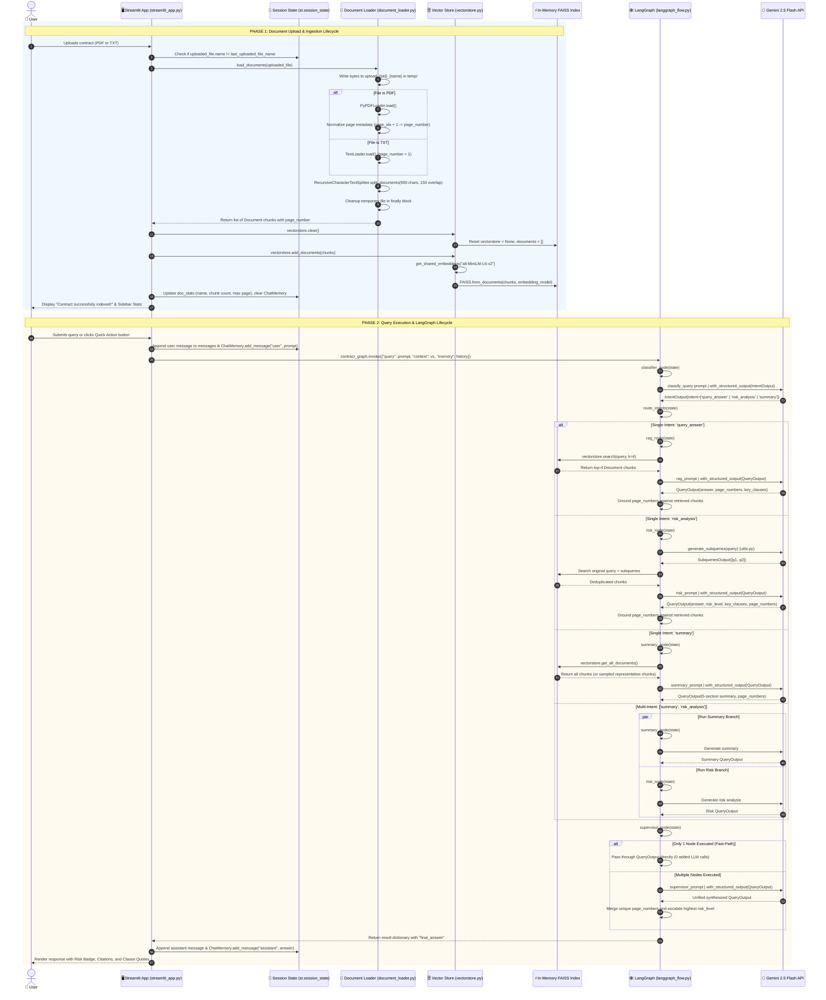

# Request Lifecycle & Sequence Flow

This document details the complete end-to-end execution lifecycle of user requests in the **Contract Review Bot**, from document ingestion to vector indexing, graph routing, inference, and UI rendering.

---

## 1. End-to-End Sequence Diagram

The following sequence diagram illustrates the exact interactions between all system components across both the **Ingestion Phase** and the **Query / Analysis Phase**:

---

## 2. Step-by-Step Lifecycle Breakdown

### Phase 1: Ingestion & Vector Indexing

1. **Upload Trigger**:
   - The user selects a `.pdf` or `.txt` contract via Streamlit's `st.file_uploader`.
   - `streamlit_app.py` checks whether the file name differs from `st.session_state.last_uploaded_file_name`. If identical, it avoids redundant re-parsing.

2. **Secure Stream Extraction**:
   - In `document_loader.load_documents(uploaded_file)`, bytes are written to a process-isolated path in `temp/` (`upload_{os.getpid()}_{filename}`).
   - Writing to disk is required because `PyPDFLoader` relies on `pypdf`/`fitz` file paths for stream reading.

3. **Page Metadata Normalization**:
   - For PDFs: Iterates through raw pages and normalizes `metadata["page_number"] = doc.metadata.get("page", 0) + 1` (converting from 0-based to 1-based indexing).
   - For TXT files: Assigns `metadata["page_number"] = 1`.

4. **Recursive Text Splitting**:
   - Chunks documents using `RecursiveCharacterTextSplitter(chunk_size=900, chunk_overlap=150)` with hierarchy `["\n\n", "\n", " ", ""]`.
   - Page metadata is carried over into every individual chunk.

5. **Deterministic Cleanup**:
   - Inside a `finally` block in `document_loader.py`, the temporary file is deleted from disk immediately after extraction, preventing disk space exhaustion and data residue.

6. **In-Memory FAISS Vector Indexing**:
   - The active session vector store is cleared via `vs.clear()`.
   - Documents are passed to `vs.add_documents(chunks)`.
   - The embedding model (`sentence-transformers/all-MiniLM-L6-v2`) computes 384-dimensional dense vectors.
   - An in-memory FAISS index (`faiss-cpu`) is constructed and retained in `st.session_state.vectorstore`.

---

### Phase 2: Query Processing & LangGraph Orchestration

7. **User Submission & Memory Registration**:
   - The user enters a question or clicks a Quick Action button (e.g. *"Identify Key Risks"*).
   - Both the UI message list and `st.session_state.ChatMemory` record the user turn.

8. **Graph Invocation**:
   - `streamlit_app.py` calls `contract_graph.invoke({"query": prompt, "context": vs, "memory": memory})`.

9. **Intent Classification & Routing**:
   - `classifier_node` prompts Gemini 2.5 Flash with `IntentOutput` schema.
   - Returns one or more of `["query_answer", "risk_analysis", "summary"]`.
   - `route_intents` determines the branch path. If unrecognized or empty, it defaults to `["rag"]`.

10. **Specialized Node Execution**:
    - **`rag_node`**: Performs similarity search (`k=4`), constructs prompt with recent dialogue context, and requests grounded answers.
    - **`risk_node`**: Expands query via sub-questions (`utils.generate_subqueries`), gathers diverse clauses, and classifies risk severity (`high`, `medium`, `low`).
    - **`summary_node`**: Samples representative chunks across preamble, body, and tail, producing an executive summary.

11. **Citation Grounding**:
    - Both RAG and Risk nodes validate the LLM's returned `page_numbers` against `retrieved_pages` from the vector search. If the LLM hallucinates an unretrieved page, it is stripped out.

12. **Supervisor Aggregation**:
    - **Fast-path (1 worker)**: Directly returns the worker's `QueryOutput`.
    - **Synthesis (>1 workers)**: Invokes a synthesis LLM chain, aggregates all cited page numbers, and promotes the highest severity risk level.

13. **UI Rendering & Report Export**:
    - Streamlit renders the assistant response with color-coded severity badges (🔴 High, 🟡 Medium, 🟢 Low), citations chips (`Page 1, 4`), and collapsible quote boxes.
    - Updates `ChatMemory` with the assistant turn.
    - Enables the *"📥 Export Review Report"* button to download the review transcript as Markdown.

---

## 3. Failure Modes & Exception Handling Matrix

| Failure Mode | Trigger / Condition | How It Is Handled | User Experience |
| :--- | :--- | :--- | :--- |
| **Unsupported File Format** | User uploads `.docx`, `.csv`, `.png` | `document_loader.py` validates extension and raises `ValueError` | Red Streamlit error notification: *"Unsupported file type. Please upload a PDF or TXT file."* |
| **Empty Document Upload** | User uploads a 0-byte or blank file | `load_documents` yields 0 chunks | Session reports 0 chunks; nodes return *"No relevant content found in document."* |
| **No Document Uploaded** | User sends a query before uploading | `state["context"]` is `None` or empty | Nodes return immediate `QueryOutput`: *"No document has been uploaded yet. Please upload a contract first."* |
| **Intent Classification Failure** | Gemini API timeout or unparseable output | `classify_query()` catches exception in `try/except` | Gracefully defaults to `["query_answer"]`; query executes via RAG node without crashing. |
| **Free-Tier Rate Limit (HTTP 429)** | >5 requests per minute on Gemini API | Node-level `try/except` catches `ResourceExhausted` | Returns `QueryOutput` explaining that quota was exceeded with retry advice instead of throwing a blank screen. |
| **Missing Tavily API Key** | User or agent invokes `LegalSearch` without key | `tools.legal_search` checks `os.getenv("TAVILY_API_KEY")` | Returns informational string: *"Tavily API key is not configured. External legal search is unavailable."* |
| **Hallucinated Page Citation** | LLM outputs a page number not in retrieved chunks | Post-processing in `rag_node` and `risk_node` | Strips hallucinated pages; only displays pages confirmed by retrieved document chunks. |
